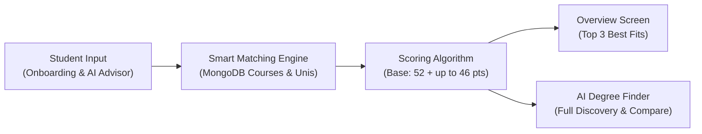
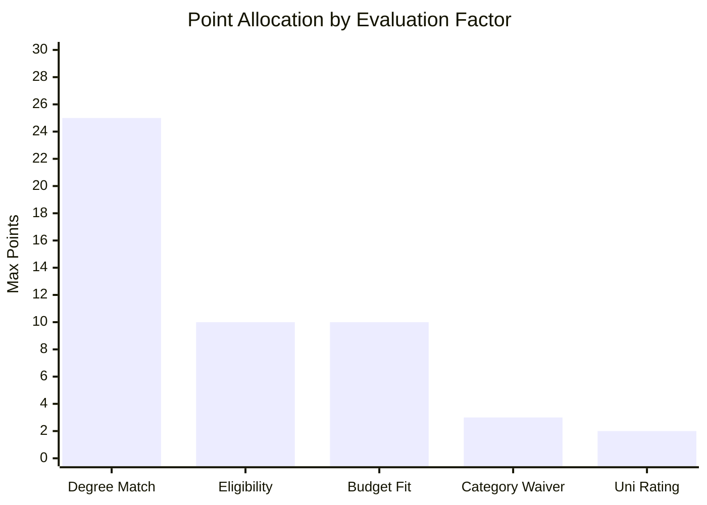
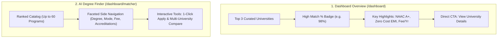

# AI Degree Matcher & Course Recommendation Engine
### Product & Business Logic Specification

---

## 1. Executive Summary & Value Proposition

The **eCampus AI Degree Matcher** and **Dashboard Overview Recommendations** bridge student aspirations with partner university offerings. Instead of presenting an uncurated directory of hundreds of generic degree listings, the engine automatically analyzes a student's academic background, financial readiness, and career targets to calculate a **live compatibility score (76% – 98%)**.

### Key Business Objectives
* **Increase Conversion Rates**: Reduce cognitive overload by delivering tailored degree recommendations with immediate social proof.
* **Maximize Lead Quality**: Ensure partner universities receive pre-screened students whose academic background and budget align with admission requirements.
* **Zero-Drop-Off Guarantee**: Dynamic constraint relaxation ensures students are never faced with a blank or zero-result search screen.

---

## 2. Core Matching Dimensions

The matching engine processes three primary pillars collected during student onboarding and AI Advisor chats:

| Dimension | Business Input | Underlying Logic |
| :--- | :--- | :--- |
| **1. Program Intent** | Target Degree / Course Choice (`coursePreference`, `course`) | Uses normalized degree tokens (`MBA`, `MCA`, `BCA`, `BBA`, `B.Com`, `DBA`, `B.Tech`, etc.) to match accredited program offerings. |
| **2. Budget Tolerance** | Financial Range (`budget`) | Translates student budget brackets into financial parameters $\left[ \text{Min}, \text{Max} \right]$ to match annual and semester program fee ranges. |
| **3. Academic Eligibility** | Highest Qualification (`highestQualification`) | Compares educational milestone (12th, Diploma, Bachelor's, Post-Graduate) against statutory university criteria (UGC/AICTE mandates). |

---

## 3. Compatibility Scoring Model

The matching score is calibrated between **76% and 98%** to maintain credibility, encourage aspiration, and signal high admission confidence without implying a guaranteed admission waiver:

$$\text{Match Score} = \text{Base (52)} + \text{Degree Fit (up to 25)} + \text{Eligibility (up to 10)} + \text{Budget (up to 10)} + \text{Category (up to 3)} + \text{Rating (up to 2)}$$

### Scoring Breakdown
1. **Degree Fit (+5 to +25 points)**:
   * **+25 pts**: Direct degree match (e.g., student wants MCA $\rightarrow$ MCA program).
   * **+15 pts**: Natural academic progression pathways (e.g., BCA $\rightarrow$ MCA, BBA $\rightarrow$ MBA).
   * **+5 pts**: Lateral or related programs.
2. **Academic Eligibility (+5 to +10 points)**:
   * **+10 pts**: Meets or exceeds entry criteria (e.g., Bachelor's holder applying for Master's/PG; 12th pass applying for UG).
   * **+6 pts**: Candidate requires bridge coursework or non-standard review.
3. **Financial Fit (+2 to +10 points)**:
   * **+10 pts**: Course annual fee falls comfortably within student's indicated budget.
   * **+8 pts**: Below budget (affordability upside).
   * **+5 pts**: Moderately above budget ($\le 25\%$ stretch), typically bridgeable via Zero-Cost EMI or scholarships.
4. **Special Category Advantage (+3 points)**:
   * Automatic boost for Defense, Merit, or Reserved categories eligible for statutory or partner fee concessions.
5. **University Benchmark (+2 points)**:
   * Institutional quality indicator (partner institutions with student ratings $\ge 4.5$).

---

## 4. Platform Touchpoints & UX Funnels

### A. Dashboard Overview (`/dashboard`)
* **Role**: **High-Intent Conversion Showcase**.
* **Display Mechanism**: Pulls the top **3 distinct universities** with the highest compatibility scores.
* **UX Strategy**: Highlights university identity, verified accreditation tags (`NAAC A+`, `UGC Entitled`), annualized fee estimates, and scholarship unlocks to drive immediate engagement.

### B. AI Degree Finder (`/dashboard/matcher`)
* **Role**: **Full Decision & Comparison Portal**.
* **Display Mechanism**: Surfaces up to **60 matched offerings**, ranked in descending order of compatibility.
* **Interactive Tooling**:
  * **Faceted Navigation**: Filter by program level, mode (*Online, Hybrid, Campus*), budget ceiling slider, and accreditations (*NAAC, UGC, AICTE, WES*).
  * **Side-by-Side Comparison**: Students can pin up to 4 programs into a sticky compare drawer to evaluate fees, duration, and approvals before applying.
  * **1-Click Apply**: Direct application fast-track.

---

## 5. Business Continuity & Fallback Logic

To prevent student bounce rates caused by restrictive filters or temporary connectivity gaps:

1. **Automatic Constraint Relaxation**: If a student enters an overly conservative budget that returns 0 programs in their chosen degree, the database automatically relaxes the budget parameter and prioritizes Zero-Cost EMI programs, keeping the student engaged.
2. **Curated Fallback Catalog**: If database latency occurs, the system renders pre-approved benchmark programs (Chandigarh University, NMIMS, Amity, Manipal) scored on the fly against the student profile.
